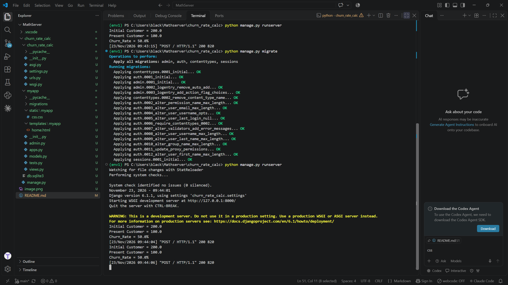
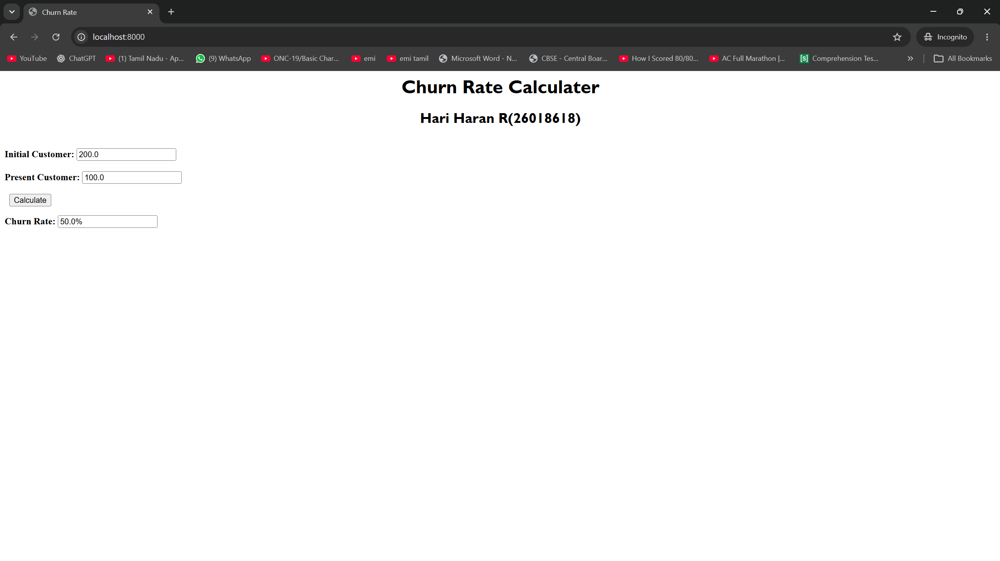

# Ex.03 Design a Website for Server Side Processing
## Date:10.11.2026

## AIM:
To create a web page to calculate Churn Rate using server-side scripts.

## FORMULA:
Churn Rate = (CustLost / InitCust) * 100
<br> InitCust --> Initial Customers Count
<br> CustLost --> Customers Lost Count

## DESIGN STEPS:

### Step 1:
Clone the repository from GitHub.

### Step 2:
Create Django Admin project.

### Step 3:
Create a New App under the Django Admin project.

### Step 4:
Create a HTML file to implement form based input and output.

### Step 5:
Create python programs for views and urls to perform server side processing.

### Step 6:
Receive input values from the form using request.POST.get().

### Step 7:
Calculate the Result using the given formula.

### Step 8:
Display the calculated result in the server console.

### Step 9:
Render the result to the HTML template.

### Step 10:
Publish the website in Localhost.

## PROGRAM:
```
home.html


<html>
<head>
    <title>Churn Rate</title>
    <link href="" rel='stylesheet'>

</head>
<body>
    <h1>Churn Rate Calculater </h1>

    <h2>Hari Haran R(26018618)</h2><br>

 <form method="POST">
         
        <label><b>Initial Customer:</b> </label>
        <input type="number" name="IC" value="{{initialcustomer}}">     
        <br><br>
        <label><b>Present Customer:</b></label> 
        <input type="number" name="PC" value="{{presentcustomer}}">
        <br><br>
        <input type="submit" value="Calculate" style="position:absolute ; top: 210; right:1620;">
        <br><br>

        <label><b>Churn Rate:</b></label >
        <input type="text" value="{{Churn_Rate}}">
 </form>

</body>
</html>

views.py

from django.shortcuts import render
def churn_rate(request):
    initialcustomer = float(request.POST.get('IC', '0'))
    presentcustomer = float(request.POST.get('PC', '0'))
    if request.method == 'POST' and presentcustomer!=0:
    
        Rate= ((initialcustomer-presentcustomer)*100)/initialcustomer  
        Churn_Rate=f"{Rate}%"
        print("Initial Customer =",initialcustomer )
        print("Present Customer =",presentcustomer)
        print("Churn_Rate =",Churn_Rate)
        return render(request, 'myapp/home.html',{'initialcustomer': initialcustomer, 'presentcustomer': presentcustomer, 'Churn_Rate': Churn_Rate})
    elif request.method == 'POST' and presentcustomer == 0:

        Churn_Rate='Cant Divide By 0'
        print("Initial Customer =",initialcustomer )
        print("Present Customer =",presentcustomer)
        print("Churn_Rate =",Churn_Rate)
        return render(request, 'myapp/home.html',{'initialcustomer': initialcustomer, 'presentcustomer': presentcustomer, 'Churn_Rate': Churn_Rate})
    else:
        Churn_Rate=0
        return render(request, 'myapp/home.html',{'initialcustomer': initialcustomer, 'presentcustomer': presentcustomer, 'Churn_Rate': Churn_Rate})


urls.py


from django.contrib import admin
from django.urls import path
from myapp import views

urlpatterns = [path('', views.churn_rate, name='churn_rate'),]
```

## OUTPUT - SERVER SIDE:


## OUTPUT - WEBPAGE:



## RESULT:
The the web page to calculate Churn Rate using server-side scripts is created successfully.
